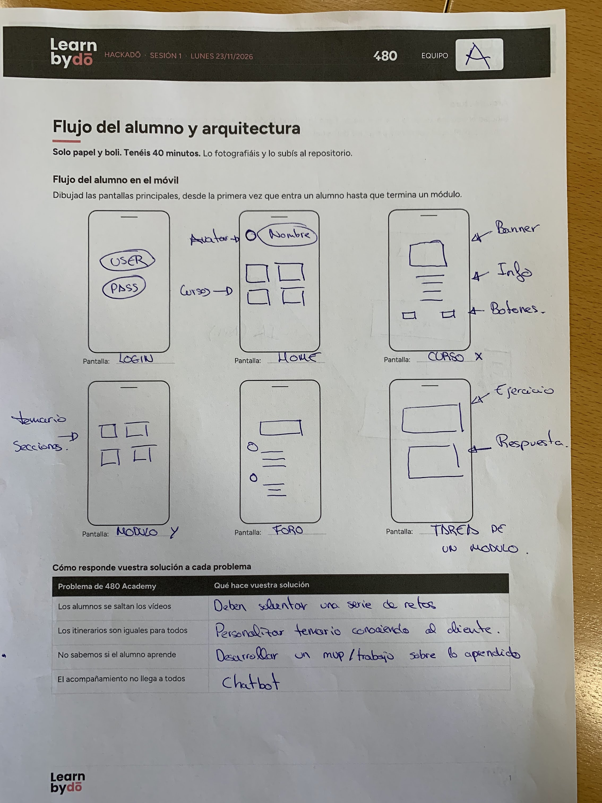
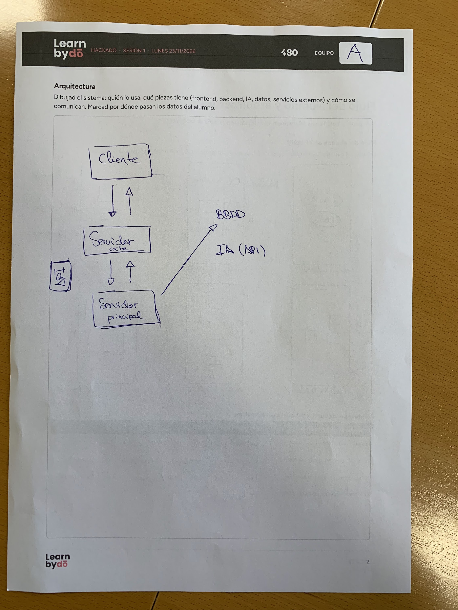

# SPEC — 480 Academy · Equipo A

> Paquete de diseño de la sesión 1 (23/11/2026). Es la base de lo que construiremos el 30/11.
>
> **Actualizado el 25/11** con el alcance del MVP: el login y el pago se simulan, no hay panel de administración, el diagnóstico inicial reordena la ruta y el alumno puede pasar una duda a un tutor humano.

---

## 1. El alumno y su problema

Es un alumno de 480 Academy que estudia desde el móvil (71 % del tráfico), con poco tiempo y un nivel previo muy variable.
Hoy recibe una lista fija de vídeos: se salta los que cree que domina, se pierde en los que no entiende y llega al examen sin saber si ha aprendido.
Paga por un acompañamiento cercano que 6 tutores no pueden dar a 1.200 alumnos.

---

## 2. Flujo del alumno

> Boceto inicial hecho a mano en la sesión presencial del 23/11. El diseño ha evolucionado desde entonces: la tabla de abajo es la versión vigente.



| # | Pantalla | Qué hace |
|---|---|---|
| 0 | **Portada pública** (`/`) | Cualquiera ve el catálogo de cursos sin entrar. |
| 1 | **Apuntarse: login y pago** | El login salta **al pulsar «Apuntarse»** en un curso, y después el pago. Quien ya tiene sesión entra directo a su panel. **En el MVP los dos son simulados:** se entra como un usuario de demo (hay uno de cada rol: alumno, profesor y admin) y se paga con un botón de prueba. |
| 2 | **Diagnóstico inicial** | Al apuntarse, unas pocas preguntas. Los módulos que el alumno ya domina quedan como **dominados** y su ruta sugerida se reordena. |
| 2b | **Panel del alumno** (`/dashboard`) | Muestra el avatar, el nombre y los cursos. Para cada módulo, una **ruta sugerida** y su estado: pendiente, en curso, dominado o completado. |
| 3 | **Curso X** | Banner, descripción y lista de módulos. El alumno los recorre en el orden que quiera (no es un itinerario lineal). |
| 4 | **Módulo Y** | Vídeos del módulo, botón al **tutor IA del módulo** y acceso a los **ejercicios de verificación**. |
| 5 | **Tutor del módulo** | Agente limitado al temario del módulo: responde dudas y genera resúmenes, tarjetas de estudio e infografías. Con el botón **«Hablar con un tutor humano»** el alumno pasa la duda a su profesor, que la responde desde el Radar. |
| 6 | **Tarea / ejercicios** | Ejercicio arriba y respuesta abajo. Tras responder, hay corrección inmediata con un enlace al minuto exacto del vídeo que hay que repasar. |
| 7 | **Foro** | Temas por clase. Las respuestas que la IA o un profesor validan como buenas dan puntos e insignias. Las tablas están listas; las pantallas quedan para después del 30/11. |
| T | **Radar del tutor** (vista del profesor) | Alumnos atascados, conceptos que fallan, dudas frecuentes por módulo y las **dudas que los alumnos han pasado a un tutor humano**, para responderlas. |

---

## 3. Respuesta a los problemas

| Problema de 480 Academy | Qué hace nuestra solución |
|---|---|
| **Los alumnos se saltan los vídeos** | Cada módulo tiene **ejercicios de verificación** generados a partir del contenido de los vídeos. Para dar el módulo por **completado** hay que resolverlos, también si el diagnóstico lo marcó como dominado. Si el alumno falla, la corrección le lleva al minuto concreto del vídeo donde se explica. Así el vídeo tiene un motivo para verse, aunque nada obliga a verlo entero. |
| **Los itinerarios son iguales para todos** | Los módulos son **no lineales**. Al apuntarse, un **diagnóstico inicial** marca como **dominados** los módulos que el alumno ya sabe y reordena su ruta sugerida, sin bloquear nada. «Dominado» solo cambia el orden: unas pocas preguntas no demuestran que sepa, así que para darlo por completado hace los ejercicios de verificación (a quien lo domina le llevan un par de minutos). El tutor IA adapta el nivel de sus explicaciones. |
| **No sabemos si el alumno aprende** | Los resultados de los ejercicios por módulo y por concepto son la **métrica intermedia** que falta entre el play y el examen final. Cada intento se registra como evento de aprendizaje. |
| **El acompañamiento no llega a todos** | Un **tutor IA por módulo**, disponible 24/7 y limitado a su temario, resuelve las dudas frecuentes. El **Radar del tutor** (idea original) señala a los 6 tutores humanos dónde hacen falta de verdad. Si la IA no basta, el alumno pasa la duda a un **tutor humano** desde el chat, y el profesor la responde desde el Radar. En la app, el tutor humano es el **profesor del curso** (no hay un rol «tutor» aparte). |

---

## 4. Historias de usuario

| # | Como... | Quiero... | Para... | Prioridad | Criterios de aceptación |
|---|---|---|---|---|---|
| H1 | alumno | preguntar dudas al tutor del módulo | resolverlas sin esperar a un tutor humano | **Imprescindible** | Responde en español, en menos de 5 s en 4G. Solo usa el temario del módulo. Ante una pregunta fuera del temario, lo dice y no inventa. Cita el vídeo y el minuto de donde sale la respuesta. |
| H2 | alumno | tener un resumen y tarjetas de estudio del módulo, y poder crearme los míos | repasar rápido desde el móvil, a mi manera | **Imprescindible** | **Común:** se genera una vez por módulo, lo revisa una persona antes de darlo por bueno y lo ven todos. El resumen va por apartados que caben en el móvil, las tarjetas se giran con un toque, y cada apartado o tarjeta enlaza al minuto del vídeo. **Personal:** el alumno elige concepto, nivel y enfoque. Cuenta como una consulta del límite diario y se marca como «generado por IA, no revisado». |
| H3 | alumno | resolver los ejercicios de verificación de un módulo | comprobar que he aprendido y completar el módulo | **Imprescindible** | Se presentan entre 5 y 8 ejercicios del banco del módulo. Las respuestas abiertas se corrigen con una rúbrica. El feedback incluye un enlace al vídeo y minuto que hay que repasar. El progreso se guarda. |
| H4 | profesor | dar ejemplos y el tipo de ejercicio de cada módulo | que la IA genere ejercicios que no se desvíen de lo que quiero evaluar | **Imprescindible** | Se configura en un fichero (sin panel de administración). Los ejercicios generados respetan el tipo y el formato de los ejemplos. El profesor puede revisarlos antes de publicarlos. |
| H5 | tutor | ver qué alumnos están atascados y en qué conceptos | dedicar mi tiempo a quien lo necesita | **Imprescindible** | El Radar lista los alumnos con fallos repetidos o inactividad, los conceptos más fallados por módulo y un resumen de las dudas frecuentes hechas al tutor IA. También muestra las dudas que los alumnos le han pasado (H9), para responderlas. |
| H6 | alumno con experiencia | hacer un diagnóstico inicial al apuntarme a un curso | no tener que ver contenido que ya domino | **Imprescindible** | Unas pocas preguntas al apuntarse. Los módulos que domina quedan como dominados y su ruta sugerida se reordena (`matricula.orden_modulos`). Nada se bloquea, y para completar un módulo dominado sigue haciendo sus ejercicios de verificación. |
| H7 | alumno | ver una infografía de cada concepto | entenderlo de un vistazo | **Deseable** | No es una imagen: la IA elige una de nuestras plantillas (capas, jerarquía, comparativa o pasos) y rellena sus datos, y nosotros la dibujamos en HTML. Es legible a 360 px, se genera una por concepto y, como el material común, solo se publica si una persona la ha revisado. |
| H8 | alumno | comentar dudas con otros alumnos en un foro y ganar puntos e insignias por las buenas respuestas | aprender con los compañeros | **Después del 30/11** | Temas por clase. La IA o un profesor validan las respuestas buenas, y el profesor prevalece. Las tablas se crean ya; las pantallas, después. |
| H9 | alumno | pasar una duda a un tutor humano cuando el tutor IA no me basta | tener el trato cercano por el que pago | **Imprescindible** | Botón «Hablar con un tutor humano» en el chat del tutor. La duda llega al Radar del profesor del curso, que la responde desde allí, y el alumno ve la respuesta en su chat marcada como «respondido por tu tutor». La IA no interviene en esa respuesta. |

---

## 5. Arquitectura

> Diagrama inicial hecho a mano en la sesión presencial del 23/11. El esquema y la tabla de abajo lo detallan y son la versión vigente.



```
 Alumno / Tutor (móvil)
        │  HTTPS
        ▼
 ┌──────────────────────┐
 │ Cliente PWA (Next.js)│  service worker: caché de la app y del material generado
 └──────────┬───────────┘
            ▼
 ┌──────────────────────┐
 │ Capa de caché        │  CDN para estáticos + caché de resúmenes, tarjetas e infografías por módulo
 └──────────┬───────────┘
            ▼
 ┌──────────────────────┐      ┌───────────────────────────┐
 │ API (Next.js routes) │─────►│ Filtro de privacidad      │──► Modelo abierto alojado en la UE
 │  · catálogo          │      │ (seudonimiza y quita PII) │    (API compatible OpenAI)
 │  · progreso          │      └───────────────────────────┘
 │  · agentes           │
 └──────────┬───────────┘
            ▼
 ┌──────────────────────┐      ┌───────────────────────────┐
 │ BBDD (PostgreSQL)    │      │ Cloudflare R2 (UE)        │  imágenes de los cursos
 │ fuente de verdad:    │      ├───────────────────────────┤
 │ usuarios, catálogo,  │      │ Stripe (modo test)        │  pago simulado de cursos
 │ documentos, material,│      ├───────────────────────────┤
 │ intentos, pagos, foro│      │ YouTube                   │  vídeos (solo se guarda el enlace)
 └──────────────────────┘      └───────────────────────────┘

 Todo desplegado en Vercel con las funciones en París (UE); PostgreSQL en Neon (UE); IA en Scaleway (París).
```

| Pieza | Qué hace |
|---|---|
| **Cliente PWA** | Next.js con Tailwind CSS y componentes de shadcn/ui, con diseño mobile-first, usable con una mano (acciones principales en la zona inferior). Es instalable y cachea la interfaz para cargar rápido en 4G. Los vídeos son *embeds* de YouTube y no se alojan aquí. En producción, con vídeos propios, irían a un servicio de vídeo con CDN en la UE y *streaming* adaptativo; en el prototipo no hace falta, porque el cliente pide no gestionar vídeo. |
| **Capa de caché** | Sirve los estáticos y el material de estudio ya generado. Un resumen o un juego de tarjetas se genera **una vez por módulo** y lo comparten todos los alumnos. |
| **API** | Rutas de Next.js. Gestiona el catálogo, el progreso y los ejercicios, y orquesta los agentes. Está diseñada como API REST documentada para facilitar la integración futura con la plataforma de 480 Academy. |
| **Filtro de privacidad** | Es código, no IA. Antes de cualquier llamada a la IA sustituye la identidad del alumno por un seudónimo y elimina datos personales del texto libre (emails, teléfonos, DNI, nombres conocidos). |
| **IA** | Modelo de pesos abiertos alojado por un proveedor europeo. Los datos no salen de la UE. Se accede a través de una capa propia que permite cambiar de proveedor sin tocar el resto. |
| **BBDD** | PostgreSQL en **Neon** (región UE), con **Drizzle** como ORM. Es la **única fuente de verdad**: usuarios, catálogo, transcripciones y apuntes en markdown, material generado, ejercicios, intentos, pagos y foro. Detalle en [`docs/bbdd/README.md`](docs/bbdd/README.md). |
| **Inicio de sesión** | **En producción:** **Better Auth**, con email y contraseña (guardada como hash) o Google. Roles: alumno, profesor y admin; el visitante es quien no ha entrado. El acceso a un curso se da a un email. **En el MVP: simulado.** Se entra como un usuario de demo del seed a través de `obtenerSesion()`, que es el único punto que cambia al conectar Better Auth. |
| **Ficheros e imágenes** | Bucket de **Cloudflare R2** con jurisdicción UE. La BBDD solo guarda la URL. |
| **Pagos** | **En producción:** **Stripe**: Checkout y un webhook verificado que crea la matrícula. **En el MVP: simulado.** Una pantalla de pago de prueba crea el `pedido`, lo marca como `pagado` con la misma función que usará el webhook y crea la matrícula. No se mueve dinero. Pasar a Stripe (primero en modo test) es cambiar esa pantalla por Checkout y añadir el webhook. |
| **Despliegue** | Vercel, conectado al repositorio de GitHub: cada cambio en `main` se publica solo y cada PR tiene su propia URL de prueba. Las funciones se ejecutan en **París** (`vercel.json`), así que los datos del alumno se procesan en la UE, junto a Scaleway. Da HTTPS, que la PWA necesita para poder instalarse. |

**Integración futura:** la plataforma actual no tiene API. Por eso el prototipo es independiente, pero cada interacción relevante (vídeo visto, ejercicio resuelto, duda planteada) se guarda como un evento con forma **xAPI**, el estándar de registros de aprendizaje. Así se podrá volcar a un LRS o a la plataforma cuando exista una vía de integración.

---

## 6. Modelo de datos y flujo hacia la IA

### Entidades principales

El modelo completo (31 tablas), sus reglas y el formato en que la IA guarda el material están en [`docs/bbdd/README.md`](docs/bbdd/README.md). Resumen:

- **Catálogo:** Categoría → Curso → Módulo → Clase (un vídeo con su transcripción y apuntes en markdown). Los módulos llevan etiquetas que usa el diagnóstico para proponer una ruta personal.
- **Usuarios:** alumno, profesor y admin, con acceso a cada curso por email (invitación o compra).
- **Aprendizaje:** ejercicios, intentos, progreso, evaluaciones (diagnóstico, test y examen) y material generado por la IA, que se guarda la primera vez y se reutiliza.
- **Tutor IA:** conversaciones (caducan a los 90 días) y límite diario de consultas. Para H9 (tutor humano) hace falta una pequeña migración: marcar un mensaje como «pasado a un tutor humano» y guardar la respuesta del profesor (hoy un mensaje solo puede ser del alumno o del tutor IA).
- **Foro:** temas por clase, respuestas validadas por la IA o un profesor, e insignias.

### Qué sale hacia la IA y qué no

| Sale hacia la IA | **No** sale nunca |
|---|---|
| Transcripciones y conceptos del módulo | Nombre, email, edad o cualquier identificador real |
| Ejemplos y rúbricas del profesor | Que el alumno es menor de edad |
| Pregunta o respuesta del alumno, **filtrada** | Historial fuera del módulo actual |
| Un seudónimo estable generado con una clave secreta (p. ej. `alumno_3f9a1c`). Sin esa clave no se puede saber quién es | Datos de otros alumnos |
| Para el Radar: estadísticas agregadas y dudas seudonimizadas | |

### Cómo cumplimos el RGPD (y la condición sobre menores)

1. **Datos en la UE:** el modelo está alojado por un proveedor europeo, con contrato de encargado del tratamiento y **sin retención ni entrenamiento** con nuestros datos. Se descartan las APIs alojadas fuera de la UE y los planes gratuitos que usan los datos para entrenar. El servidor de la app (Vercel) y la base de datos también están en la UE.
2. **Minimización:** la IA nunca necesita saber quién es el alumno. La relación entre el seudónimo y el alumno solo vive en nuestra BBDD.
3. **Filtro de PII:** el texto libre se limpia antes de enviarse, porque un alumno puede escribir su teléfono en una duda.
4. **Menores:** se exige el consentimiento del tutor legal para menores de 14 años (art. 7 LOPDGDD). Se aplican las mismas reglas a todos los alumnos, sin un trato especial que requiera enviar la edad.
5. **Retención limitada:** las conversaciones se borran a los 90 días y el progreso se conserva mientras dure la matrícula.
6. **Transparencia:** el alumno sabe que habla con una IA y puede pasar su duda a un tutor humano con un botón del chat (H9). Esa respuesta la escribe el profesor, sin IA, y se marca como «respondido por tu tutor».

---

## 7. Agentes de IA

Las instrucciones completas de cada agente estarán en `agents/` (Markdown).

| Agente | Qué hace | Modelo y por qué | Entrada | Salida | Límites |
|---|---|---|---|---|---|
| **Tutor del módulo** | Responde dudas y genera resúmenes, tarjetas de estudio e infografías del módulo | `gemma-4-26b-a4b-it` en Scaleway (UE), sin razonamiento. Es barato, responde en ~0,5 s y va bien en español, que es lo que pide una interacción frecuente. Superó nuestras pruebas: se ciñe al temario, rechaza lo que queda fuera, devuelve JSON válido y corrige con rúbrica | Temario del módulo (transcripciones y conceptos), pregunta filtrada, últimos mensajes | Texto, o JSON estructurado (tarjetas, diagrama Mermaid) | **Solo** su temario: fuera de él responde «eso no está en este módulo». Cita la fuente (vídeo y minuto). No hace ejercicios por el alumno. Limita los mensajes diarios por alumno |
| **Generador de ejercicios** | Crea el banco de ejercicios de cada módulo a partir de los ejemplos del profesor | Modelo abierto más grande, también en la UE. Se ejecuta **una vez por módulo** (no por alumno), así que su coste es despreciable y compensa la calidad | Transcripciones, conceptos, ejemplos y tipo de ejercicio del profesor | JSON de ejercicios en estado *borrador*, con solución o rúbrica y vídeo y minuto de referencia | Mismo tipo y formato que los ejemplos. Solo contenido del módulo. **El profesor aprueba** antes de publicar. Ningún dato de alumnos |
| **Corrector** | Evalúa respuestas abiertas con la rúbrica y explica el error | Modelo mediano. Las preguntas tipo test se corrigen con código, sin IA | Enunciado, rúbrica, respuesta filtrada | Puntuación, feedback breve, vídeo y minuto que hay que repasar | Se ciñe a la rúbrica. Si no tiene confianza, lo marca para revisión humana |
| **Analista del Radar** | Resume para el profesor qué temas preocupan a sus alumnos y qué repasar en clase | `gemma-4-26b-a4b-it` en Scaleway (UE), sin razonamiento. Se pide al abrir el Radar, aparte de los números, con caché de 1 hora por curso: unos 700 tokens de entrada, menos de 0,001 € por resumen | Textos de las dudas al tutor (ya filtrados) agrupados por módulo, y conceptos más fallados (calculados por código). **Nunca quién preguntó** | Resumen de 3 a 5 frases con una sugerencia para la clase (JSON validado) | Habla de temas, nunca de alumnos. Las dudas van en el mensaje del usuario, no en las instrucciones. Si falla, solo falla su tarjeta: el Radar sigue. Instrucciones en `agents/analista-radar.md` |
| **Revisor de transcripciones** (solo en producción) | Corrige el vocabulario técnico de cada transcripción (`createElement`, `div`, `append`, números dictados) antes de guardarla | `gemma-4-26b-a4b-it` en Scaleway (UE), sin razonamiento. Es una tarea sencilla de texto y se ejecuta **una vez por vídeo**: unos 0,003 € por vídeo, alrededor de 1 € para los 400 del catálogo | Bloques de transcripción sin las marcas de tiempo, título del vídeo y conceptos del módulo. Ningún dato de alumnos | Los mismos bloques, en el mismo orden, corregidos. El código vuelve a poner los tiempos | No resume, no añade ni quita contenido. Si un bloque cambia demasiado o falta, se conserva el original. Un profesor puede revisar el resultado. **No se usa en el prototipo** (ver apartado 8) |

---

## 8. Contenido

**Curso elegido:** *Introducción al desarrollo web* (HTML, CSS y JavaScript). Tiene mucho contenido en español en YouTube y unos ejercicios prácticos que lucen en la demo.

Usamos 12 vídeos de dos canales de YouTube en español: **Kiko Palomares** (HTML, maquetación y JavaScript) y **Dorian Desings** (CSS, de su curso de CSS). Los elegimos por contenido: cada vídeo explica de verdad los conceptos de su módulo, que comprobamos leyendo las transcripciones.

| Módulo | Vídeo | Duración | Subtítulos |
|---|---|---|---|
| M1 · HTML | v01 · [Cómo están hechas las páginas web](https://www.youtube.com/watch?v=81u19umYU_E) | 6:43 | automáticos |
| | v02 · [Estructura de un documento HTML](https://www.youtube.com/watch?v=_MTZx8H-Fo4) | 7:12 | automáticos |
| | v03 · [Etiquetas semánticas](https://www.youtube.com/watch?v=FeXpLU515AI) | 4:49 | automáticos |
| M2 · CSS | v04 · [Especificidad y cascada](https://www.youtube.com/watch?v=6fh7ZTj2t2k) | 16:12 | a mano |
| | v05 · [El modelo de caja](https://www.youtube.com/watch?v=-ivUAB-aG2U) | 4:17 | automáticos |
| | v06 · [Unidades de medida: em y rem](https://www.youtube.com/watch?v=4DgjXh-h2xI) | 11:35 | a mano |
| M3 · Maquetación responsive | v07 · [Flexbox](https://www.youtube.com/watch?v=-nVJwYKx6H8) | 11:01 | automáticos |
| | v08 · [CSS Grid](https://www.youtube.com/watch?v=edEG0CoM5gw) | 11:51 | automáticos |
| | v09 · [Media queries y diseño responsive](https://www.youtube.com/watch?v=pu6ArfDxxpE) | 5:20 | automáticos |
| M4 · JavaScript | v10 · [Variables, condicionales, bucles y funciones](https://www.youtube.com/watch?v=oqXYMnmq3c8) | 20:32 | automáticos |
| | v11 · [Modificar el DOM](https://www.youtube.com/watch?v=H7CC46Hi0YA) | 12:51 | automáticos |
| | v12 · [Eventos](https://www.youtube.com/watch?v=griNhCfEIOM) | 12:11 | automáticos |

Los vídeos, sus duraciones y los 3 conceptos de cada módulo están en `data/catalog.json`; las transcripciones, en `data/transcripciones/v01.vtt` … `v12.vtt`. Son el origen del seed de la BBDD (ver [`docs/bbdd/README.md`](docs/bbdd/README.md)).

### Cómo obtuvimos las transcripciones

**En el prototipo** no hizo falta transcribir: los 12 vídeos ya tenían subtítulos en español en YouTube (2 puestos a mano por el autor y 10 automáticos). El script `scripts/transcripciones/descargar.py`:

1. Descarga con **yt-dlp** solo los subtítulos en VTT, sin bajar el vídeo ni el audio. Prefiere los hechos a mano y, si no hay, usa los automáticos.
2. **Los limpia.** Los automáticos repiten cada frase 2 o 3 veces porque en pantalla «ruedan» de una línea a la siguiente; sin limpiar, el temario que recibe el tutor duplicaría los tokens. También quita las etiquetas de tiempo por palabra y entidades como `&nbsp;`.
3. Agrupa el texto en bloques de unos 10 segundos, **conservando el segundo en que empieza cada bloque**. Es lo que permite al tutor citar el minuto exacto.
4. Guarda `data/transcripciones/<vídeo>.vtt` y anota el fichero en `catalog.json`.

Todo tarda menos de un minuto y no cuesta nada. Elegimos este camino por sencillez: Whisper en un portátil sin tarjeta gráfica habría tardado horas para las ~2 horas de vídeo, y no habría resuelto los fallos que más nos importan (ver abajo).

**Calidad.** Los subtítulos, sobre todo los automáticos, no tienen puntuación y fallan en vocabulario de programación: «create Element» por `createElement`, «dip» por `div`, «a pen» por `append`, o «0 10» donde el autor dicta la especificidad (0,1,0). Lo comprobamos con el tutor:
- Los fallos **evidentes** los corrige el propio modelo por el contexto: preguntando cómo crear un elemento, respondió con `document.createElement('div')` y `append` aunque la transcripción dijera otra cosa.
- Los que **cambian el sentido** no: con el «0 10» explicó mal los valores de la especificidad.

En el prototipo lo aceptamos: el tutor recibe el módulo entero y la mayoría de fallos se resuelven por contexto.

**En la app real** los vídeos son de 480 Academy y no están en YouTube. El proceso se dispara solo cuando un profesor sube un vídeo, en un trabajo en segundo plano:

1. **Whisper** (modelo abierto, en servidores propios o de la UE, sin enviar el audio a terceros) transcribe el 70 % del catálogo que no tiene transcripción. Devuelve VTT con marcas de tiempo, igual que ahora. Para el 30 % que ya la tiene, se parte de ella.
2. **Limpieza** con código, como en el prototipo.
3. **Revisor de transcripciones**, un agente de IA (ver apartado 7 y [`agents/revisor-transcripciones.md`](agents/revisor-transcripciones.md)): corrige el vocabulario técnico sin cambiar el contenido ni los tiempos. Whisper transcribe mejor que los subtítulos automáticos, pero sigue fallando en nombres de código y en números dictados.
4. **Conversión a markdown** con marcas `[mm:ss]` y guardado en la tabla `documento`. Un profesor puede revisarla antes de publicar.

El revisor es necesario en producción por dos motivos: con 400 vídeos el tutor busca los fragmentos relevantes (RAG) en lugar de recibir el módulo entero, y una búsqueda de «div» no encuentra un fragmento que dice «dip»; y las transcripciones se reutilizan como apuntes y para generar resúmenes, tarjetas y ejercicios. Se ejecuta una vez por vídeo y cuesta céntimos.

**Conceptos.** Los 3 conceptos de cada módulo los revisamos con las transcripciones reales y ajustamos sus nombres a lo que explican los vídeos. Sus identificadores no cambiaron, porque los usan los ejercicios, el material y los datos del Radar.

---

## 9. Coste

**Hipótesis por alumno activo y mes:**
- 20 consultas al tutor. Cada una envía el temario completo del módulo (unos 12.000 tokens) más el historial (unos 2.000) y recibe unos 500 tokens. *Medido con las transcripciones reales (24/11): el temario va de unos 5.300 tokens (HTML) a unos 13.000 (JavaScript), unos 8.000 de media. Mantenemos 12.000 como hipótesis conservadora.*
- 10 respuestas abiertas corregidas por IA (unos 3.000 tokens de entrada cada una).
- Resúmenes, tarjetas, infografías y banco de ejercicios: se generan **una vez por módulo** y se comparten, así que su coste por alumno es casi nulo.
- Transcripciones: coste **único por vídeo**, no por alumno. En el prototipo, 0 € (subtítulos de YouTube). En producción, Whisper en servidores propios más el revisor de transcripciones, unos 1 € de IA para los 400 vídeos.
- **Modelo elegido:** `gemma-4-26b-a4b-it` (pesos abiertos) en **Scaleway Generative APIs**, alojado en la UE y sin retención de datos. **Precio real: 0,25 € por millón de tokens de entrada y 0,50 € por millón de salida.**
- **Sin razonamiento** (`reasoning_effort: "none"`): lo medimos el 23/11 con la misma pregunta. Con razonamiento tardó 3 s y gastó 303 tokens de salida (276 de razonamiento invisible); sin él, 0,5 s y 23 tokens, con una respuesta igual de buena. Solo se activará para tareas difíciles si hace falta.

| Concepto | Tokens/mes | Coste |
|---|---|---|
| Tutor (entrada) | ~280.000 | ~0,07 € |
| Tutor (salida) | ~10.000 | ~0,005 € |
| Corrector | ~30.000 entrada + ~3.000 salida | ~0,01 € |
| **Total por alumno medio** | | **≈ 0,08 €/mes** |
| Alumno muy activo (×3) | | ≈ 0,25 €/mes |
| **1.200 alumnos** | | **≈ 100 €/mes** |
| Peor caso por alumno (agota el límite de 30 consultas diarias todo el mes) | ~12,6 M entrada | ≈ 3,40 €/mes, que es el **techo** que fija el límite |

**Cómo lo reduciríamos:**
1. **Recuperación por fragmentos (RAG):** enviar solo los trozos de transcripción relevantes y no el módulo entero. La entrada baja un 70–80 %, hasta unos **0,03 €/alumno/mes**.
2. **Caché de material y de preguntas frecuentes:** las preguntas repetidas se responden desde la caché, sin llamar al modelo.
3. **Tipo test corregido por código:** solo las respuestas abiertas pasan por la IA.
4. **Límite diario de consultas** por alumno, que da un coste máximo predecible.
5. **Prompt caching** si el proveedor lo ofrece, porque el temario del módulo es un prefijo fijo.

---

## 10. Idea original: Radar del tutor

**Qué es:** un panel para los 6 tutores que cada mañana les dice **a quién atender y por qué**. Cruza los resultados de los ejercicios y las dudas hechas al tutor IA. Muestra:
- alumnos con fallos repetidos en un mismo concepto o con días sin actividad,
- los conceptos que más se fallan en cada módulo,
- un resumen de las dudas frecuentes, con la respuesta que dio el tutor IA para que el humano la valide o la corrija,
- las dudas que los alumnos le han pasado a un tutor humano (H9), para responderlas desde ahí.

**Por qué mejora la experiencia:**
- **Para el tutor:** 1.200 alumnos entre 6 tutores es imposible de seguir uno a uno. El Radar convierte ese volumen en una lista corta y priorizada, y el tutor dedica su tiempo a quien lo necesita.
- **Para el alumno:** recibe la atención cercana que paga justo cuando se atasca, no cuando ya ha abandonado.
- **Para 480 Academy:** si un concepto lo falla todo el mundo, el problema está en el vídeo y no en el alumno. Es información para mejorar el catálogo.

---

## 11. Alcance para el 30/11

| Entra | Por qué |
|---|---|
| PWA mobile-first con portada pública, panel del alumno, Curso y Módulo, y ruta sugerida | Es el recorrido de la demo, que se hará desde el teléfono |
| Catálogo de 4 módulos y 12 vídeos, cargado en la BBDD con el seed (desde `catalog.json`). Los otros 5 cursos del seed son **solo de escaparate** en la portada, sin contenido | Condición del reto: el catálogo se da por cargado |
| **Login simulado** con usuarios de demo de cada rol | Permite enseñar el acceso al curso y la vista del profesor sin montar la autenticación real |
| Diagnóstico inicial y ruta personal por etiquetas (H6) | Responde a «los itinerarios son iguales para todos» y es el centro de la demo |
| **Compra simulada:** Apuntarse → login → pago de prueba → matrícula → acceso | Enseña el circuito completo sin depender de Stripe |
| Tutor del módulo: dudas, resumen y tarjetas | Es el núcleo de la propuesta de IA |
| Pasar una duda a un tutor humano y responderla desde el Radar (H9) | Responde a «prometemos un acompañamiento que no damos»: la IA filtra lo frecuente y el humano llega a quien lo necesita |
| Ejercicios de verificación pregenerados, con corrección y enlace al minuto | Responde a «se saltan vídeos» y a «no sabemos si aprende» |
| Radar del tutor básico | Es nuestra idea original |
| Filtro de privacidad y seudonimización | Es una condición del cliente y un criterio de evaluación |
| Instrucciones de los agentes en `agents/` | Es un entregable |
| Despliegue en Vercel con PostgreSQL en la UE | La demo se hace desde un móvil cualquiera con una URL fija y HTTPS (necesario para instalar la PWA). El cliente puede probarla desde su teléfono y no dependemos de la wifi del aula ni de un portátil |

| Queda fuera | Por qué |
|---|---|
| Pantallas del foro, insignias y exámenes con nota | Las tablas quedan creadas; las pantallas no caben en 4 horas |
| Iniciar sesión con Apple | Exige una cuenta de pago de Apple Developer |
| Notificaciones push y repaso espaciado | Encaja como evolución, pero no cabe en 4 horas |
| Integración con la plataforma actual | Sin API. Lo dejamos preparado con eventos xAPI |
| RAG | Con 12 vídeos cabe el temario entero en el contexto. Sí entra en producción por coste |
| Infografías | Deseables: entran solo si sobra tiempo |
| **Panel de administración** para crear o cargar cursos | El cliente lo descarta: «Tampoco queremos un panel de administración para cargar contenido». El catálogo se carga con el seed. Los roles de profesor y admin existen, pero la demo enseña el recorrido del alumno y el Radar |
| **Login con Better Auth y pago con Stripe reales** | Diseñados (apartado 5) y aislados para cambiarlos sin tocar el resto. Entran si sobra tiempo; el login va primero, porque los permisos dependen de él |

### Recorrido de la demo (5 minutos, desde el móvil)

1. El alumno entra en la portada y ve los cursos.
2. Elige *Introducción al desarrollo web* → **Apuntarse** → login y pago simulados.
3. Hace el **diagnóstico inicial**: HTML sale como dominado y su ruta empieza por CSS.
4. Entra en CSS, ve un vídeo y **pregunta al tutor**, que responde citando el minuto. Una duda que no le basta la **pasa a un tutor humano**.
5. Consulta el **material** del módulo (resumen o tarjetas).
6. Hace los **ejercicios de verificación**, falla uno y la corrección le lleva al minuto exacto del vídeo.
7. Cambia a la vista del profesor: el **Radar** muestra los alumnos atascados (datos simulados) y la duda del paso 4, que responde. El alumno ve la respuesta en su chat.

### Mejoras para producción

- **«Practicar más»:** más ejercicios del banco del módulo, centrados en el concepto que el alumno falla. No tiene coste de IA salvo la corrección de las respuestas abiertas.
- **Revisión de ejercicios desde la app:** en el prototipo los revisamos nosotros, en la BBDD. En producción, el profesor los revisa en una pantalla de la app (solo los de sus cursos), los aprueba, corrige o descarta, y puede pedir otros nuevos, de todo el módulo o de uno solo, diciendo por qué no le gustaban. Detalle en [`agents/generador-ejercicios.md`](agents/generador-ejercicios.md).

### Preparación imprescindible antes del 30/11

| Tarea | Por qué |
|---|---|
| **Datos simulados para el Radar:** unos 30 alumnos ficticios con intentos, fallos y dudas que formen patrones realistas (p. ej. «el 60 % falla especificidad en CSS») | Con 4 alumnos de demo el Radar sale vacío y la idea original no se aprecia |
| **Material pregenerado:** resúmenes, tarjetas y banco de ejercicios de los 4 módulos, generados y guardados antes de la demo | La demo no depende de que la IA responda en directo. En directo solo van el chat del tutor y la corrección |
| ✅ **Alta en el proveedor de IA:** hecha el 23/11 en Scaleway, con `gemma-4-26b-a4b-it` probado en español | El alta puede pedir verificación y pago. Si falla, aún hay margen para cambiar de proveedor |
| **Ejemplos del profesor:** 2 o 3 ejercicios de ejemplo por módulo, de tipos distintos (test, respuesta corta, código) | El generador de ejercicios parte de ellos. En el prototipo hacemos de profesor nosotros |
| **Tailwind CSS + shadcn/ui** como base visual | Nadie del equipo tiene el frontend como punto fuerte. Los componentes ya hechos aseguran que se vea bien en el móvil |
| **Desplegar en Vercel cuanto antes** y probarlo desde un móvil (instalar la PWA, preguntar al tutor) | Los problemas de despliegue salen mejor durante la semana que el día de la demo |

### Riesgos y mitigación

| Riesgo | Mitigación |
|---|---|
| El proveedor de IA tarda o falla durante la demo | Material pregenerado y respuestas de reserva para las preguntas del guion de la demo |
| Respuestas pobres del modelo abierto en español | Probarlo esta semana. La capa propia permite cambiar de modelo o de proveedor con un cambio de configuración |
| Poca experiencia en frontend | Componentes ya hechos y un responsable de la base visual y la navegación |
| Las tareas paralelas chocan el 30/11 | El contrato (tipos compartidos, esquema de la BBDD y formato de los ejercicios) queda cerrado antes de la sesión |
| La versión desplegada falla el día de la demo | Plan B: la app arrancada en un portátil conectado al punto de acceso del móvil (sin depender de la wifi del aula) |
| El pago simulado crea matrículas sin cobrar | Solo existe en la demo, está aislado en una función y se marca como tal. En producción la matrícula de compra la crea únicamente el webhook verificado de Stripe |

### Preguntas abiertas al cliente

1. ¿Queréis que el **examen final** se desbloquee cuando el alumno haya verificado todos los módulos? Los módulos siguen siendo libres entre sí.
2. ¿Os importa que vean los **vídeos enteros**, o que interioricen los conceptos, los vean o no? Si importa el visionado, podemos medir qué parte de cada vídeo se ve con la API del reproductor de YouTube, como otra métrica intermedia.
